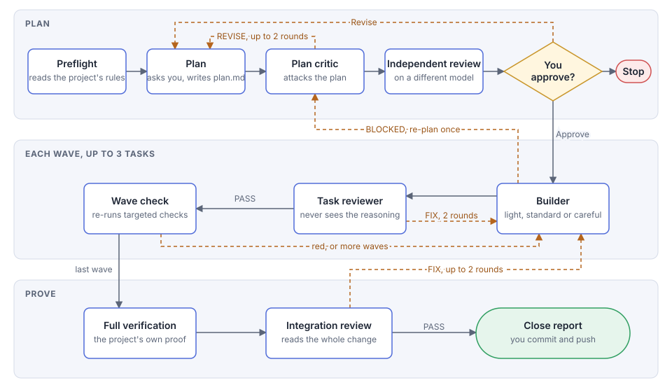

# alien-coding

A [Claude Code](https://claude.com/claude-code) skill that carries out one coding task with a planned, reviewed team of subagents. You type `/alien-coding <task>`, approve a plan, and get a change that has been reviewed and proved.

## How a run goes



1. **Plan.** The main session explores the project, asks you what only you can decide, and writes `plan.md`.
2. **Critique.** A critic and an independent reviewer on a different model try to break the plan.
3. **Approve.** Nothing is built until you say so.
4. **Build.** Tasks go to builders at three tiers (light, standard, careful), test first.
5. **Review.** A separate reviewer checks each task without seeing the builder's reasoning.
6. **Check.** After each wave of tasks, the orchestrator re-runs every targeted check.
7. **Prove.** The project's full verification runs, then an independent integration review reads the whole change.

This graph shows the full path. `--fast` skips the critic, the waves and the integration review.

Everything a run writes goes to `.claude/alien-coding/<slug>/` in your project.

## Install

```bash
git clone https://github.com/jdimko/alien-coding.git
node alien-coding/install.js
```

The installer copies the skill and agents into `~/.claude`, overwriting any earlier copy, and installs the third-party [`ui-ux-pro-max`](https://github.com/nextlevelbuilder/ui-ux-pro-max-skill) plugin at its latest version. Use `--no-plugin` to skip the plugin. Restart Claude Code afterwards so it finds the agents.

## Use

```
/alien-coding <task>
/alien-coding --fast <task>
```

Every run takes the full path. `--fast` asks for a shorter path, and the skill only takes it if the task passes every check for it.

You can start in an empty folder. The skill runs `git init`, makes an empty first commit, asks what the task leaves open, and ends by writing a `CLAUDE.md` for later runs. In a folder that has files but no git, it asks first.

## Requirements

- Claude Code with access to Opus 5.5 and Fable 5.1. The model of each agent is set in its frontmatter, so change it there if yours differ.
- Node.js, for the installer and `readonly-guard.js`.
- Git, with your user name and email set. In an existing project, a `CLAUDE.md` that names its full verification command and its sensitive areas. The skill is not tied to any language or framework: it takes its rules and its proof from your project.
- Optional, for UI work: the `ui-ux-pro-max` plugin, which the installer adds, and the `visualize` tool in the Claude desktop app. Without the plugin, the UI spec comes from your project's own rules. Without `visualize`, mockups fall back to ASCII.

The rest adapts to what your project has. Mutation tests, Stop hooks that hold a turn open, and required reviews of its own are all optional, and the skill handles them only if it finds them.

## Cost

This is a heavy pipeline, built for changes where being wrong costs more than the tokens. Two large real features each took 6 to 10 active hours, about half of it running tests and builds, and used a lot of tokens. For a small change, use Claude Code directly or try `--fast`.

## Safety

`readonly-guard.js` is a deny-list that catches mistakes by the read-only agents. It is not a sandbox. The agents' own rules are the real boundary, so review what a run does as you would any other agent's work.

## License

[MIT](LICENSE)
